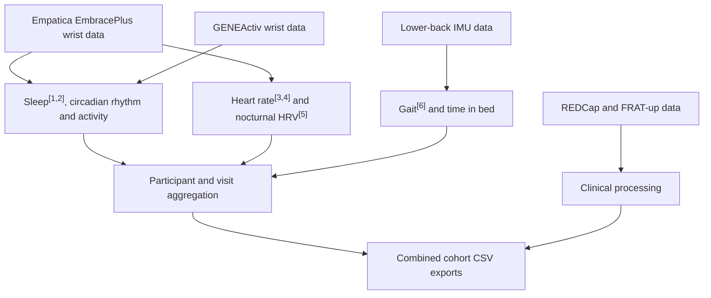

# DARE-wearable-pipelines

[](https://github.com/marcellosicbaldi/DARE-wearable-pipelines/actions/workflows/ci.yml)

Research wearable workflows for the DARE-FALLSPREDICT GP and DARE-FALLSPREDICT studies:

- Empatica EmbracePlus wrist sleep, circadian rhythm, activity intensity, heart rate and HRV
- GENEActiv wrist sleep, circadian rhythm and activity intensity
- Lower-back IMU gait and time-in-bed processing
- REDCap, FRAT-up import and combined cohort aggregation

This repository contains the sanitized public workflows, with regression cases and fixes
for the reviewed processing errors and an extracted shared processing core.
Installation uses a locked environment, and GitHub Actions validates the
distribution. The project is MIT-licensed, with incorporated-source notices
preserved alongside the code.
The existing `fallspredict_gp_pipeline` / `fallspredict_pipeline` console commands are retained.

## Workflow overview

Device-specific preprocessing feeds shared feature extraction and aggregation
for both studies. Sensor summaries are joined with clinical data for combined
cohort exports.



## Contents

```text
configs/       Generic example configurations; no private study settings
docs/          Processing and data-contract documentation
notebooks/     Four unexecuted entry-point examples
scripts/       Publication-content checks
src/           Shared core and DARE-FALLSPREDICT GP/DARE-FALLSPREDICT adapters
tests/         Synthetic regression tests
```

Study data, saved notebook results, exploratory/legacy notebooks, local
diagnostic reports, editor state and third-party reference PDFs are not included.

## Shared architecture

Keep both cohorts in one repository and branch. Cohort differences are explicit
configuration and sensor adapters; separate branches would duplicate processing
fixes and make the two implementations drift.

```text
src/dare_wearables/     Sensor readers, preprocessing, algorithms, shared runners,
                       clinical processing and aggregation calculations
src/fallspredict_gp_pipeline/  DARE-FALLSPREDICT GP configuration, commands and default paths
src/fallspredict_pipeline/     DARE-FALLSPREDICT configuration, commands and GENEActiv orchestration
```

Both adapters depend on `dare_wearables`; the core imports neither cohort.
Empatica EmbracePlus and GENEActiv preprocessing retain their device-specific loading and
nonwear rules, then feed the same `run_wrist_from_preprocessed` stage sequence.
The shared lower-back runner accepts either cohort's configuration. Aggregation
adapters supply sensor folders and gait QC policy explicitly. Existing import
paths forward to the core or use small wrappers that preserve their defaults.

For new Python integrations, use the neutral APIs in
`dare_wearables.wrist.sleep.pipeline` (`run_wrist_from_empatica`,
`run_wrist_from_empatica_silver`, `run_wrist_from_preprocessed`) and
`dare_wearables.lower_back.pipeline` (`run_from_config`). Shared aggregation
functions require explicit roots and sensor subdirectories. See the
[architecture diagram](docs/pipeline_diagram.md).

## Setup and private configuration

Download a [GitHub release](https://github.com/marcellosicbaldi/DARE-wearable-pipelines/releases), or clone the repository and check out the desired release tag. Enter the repository directory,
and install [uv](https://docs.astral.sh/uv/getting-started/installation/) version
`0.12.23`. Then:

```bash
uv sync --locked
cp configs/empatica_sleep.example.toml configs/empatica_sleep.local.toml
```

This creates an isolated `.venv` and installs all three packages. For BeliefPPG
heart-rate inference, install the additional TensorFlow dependencies:

```bash
uv sync --locked --extra heart-rate
```

Activate the environment before running commands (`source .venv/bin/activate`
on macOS/Linux), or prefix each command with `uv run --no-sync`.
`uv sync` without the extra removes optional heart-rate dependencies; use
`uv run --no-sync` to preserve your chosen environment. HRV does not require
this extra.

For a plain pip installation from the downloaded source, use Python 3.11 and
`python -m pip install .` (or `'.[heart-rate]'`). This pins direct dependencies
but does not reproduce every transitive version from `uv.lock`; the locked
workflow above is the reference installation. See
[GitHub installation and releases](docs/installation_and_releases.md) for wheel
installation, dependency updates and release checks. The project is distributed
through GitHub only; it is not published on PyPI.

Copy each required `configs/*.example.toml` to the corresponding `*.local.toml`,
then edit that local file with your private paths and participant selection.
Local configuration files are ignored by Git and excluded from distributions.
Examples use the fictional identifier `900001`; no example data is supplied.

## Run

After preparing the matching local configuration:

```bash
gp-empatica-sleep --config configs/empatica_sleep.local.toml --participant 900001 --combined
ravenna-sleep --config configs/ravenna_sleep.local.toml --participant 900001 --combined
gp-lower-back --config configs/lower_back.local.toml --participant 900001
ravenna-lower-back --config configs/ravenna_lower_back.local.toml --participant 900001
gp-heart-rate --config configs/heart_rate.local.toml --participant 900001 --visit T0
gp-hrv --config configs/hrv.local.toml --participant 900001
```

Equivalent examples are in `notebooks/`. Keep notebook outputs cleared before
committing. Inspect participant selection before any batch run.

## Input and output contracts

Empatica EmbracePlus sleep expects `silver/<participant>/<visit>/Empatica/acc.parquet` and
`temp.parquet`. HR and HRV expect `ppg.parquet` and `acc.parquet`. HRV also uses
sleep windows from `Empatica/sleep_circadian/sleep_output_all_guiders.csv`.
Optional diary, recruitment tracker and lower-back TIB inputs are configured
privately. GENEActiv expects a participant/visit `.bin` recording; see the
[DARE-FALLSPREDICT input conventions](src/fallspredict_pipeline/README.md).

Lower-back processing expects `bronze/<participant>/<visit>/<sensor>/*.OMX`
and requires REDCap metadata for gait processing. Its outputs include daily
gait, walking bouts, nonwear and time-in-bed tables. Wrist outputs live under
the participant/visit/sensor folder, with `sleep_circadian`, `beliefppg`, `hrv`
and `nocturnal_bursts` subdirectories as selected by the configuration.

All generated outputs and clinical/sensor inputs remain private. Omitting an
ID column from an export is not an anonymization procedure.

## Aggregation

```bash
gp-aggregate-all --silver-root "$HOME/dare-data/silver" --visit T0
gp-aggregate-redcap --redcap-csv "$HOME/dare-data/REDCap/Bologna/fallspredict_data.csv" --output-dir outputs/redcap
```

See [combined cohort assembly](docs/combined_cohorts.md),
[REDCap processing](docs/redcap_processing.md), and
[aggregation thresholds](docs/aggregation_thresholds_and_nonwear.md).

## Checks

```bash
uv run --no-sync python -m unittest discover -s tests -v
uv run --no-sync python scripts/check_publication.py
uv run --no-sync python scripts/check_install.py
```

The publication check inspects Git-visible working files and staged content
for disallowed files, local paths, common credential patterns and notebook
execution state. It reports locations, not sensitive values. It does not inspect
Git history or certify arbitrary text as anonymous; keep future additions limited
to reviewed code, prose and synthetic examples.

## References

1. **Sleep (sustained inactivity):** van Hees, V. T., et al. (2015).
   [A Novel, Open Access Method to Assess Sleep Duration Using a Wrist-Worn Accelerometer](https://doi.org/10.1371/journal.pone.0142533).
   *PLOS ONE*, 10(11), e0142533.
2. **Sleep (HDCZA):** van Hees, V. T., et al. (2018).
   [Estimating sleep parameters using an accelerometer without sleep diary](https://doi.org/10.1038/s41598-018-31266-z).
   *Scientific Reports*, 8, 12975.
3. **Heart rate (BeliefPPG):** Bieri, V., Streli, P., Demirel, B. U., and Holz, C. (2023).
   [BeliefPPG: Uncertainty-aware heart rate estimation from PPG signals via belief propagation](https://proceedings.mlr.press/v216/bieri23a.html).
   *UAI*, Proceedings of Machine Learning Research, 216, 173–183.
4. **Heart-rate benchmarking:** Sicbaldi, M., et al. (2025).
   [Benchmarking of open-source algorithms for heart rate estimation from motion-corrupted photoplethysmography](https://doi.org/10.1016/j.compbiomed.2025.110808).
   *Computers in Biology and Medicine*, 196, 110808.
5. **PPG beat detection (MSPTDfast):** Charlton, P. H., Mant, J., and Kyriacou, P. A. (2024).
   [MSPTDfast: An Efficient Photoplethysmography Beat Detection Algorithm](https://doi.org/10.22489/CinC.2024.045).
   *Computing in Cardiology*, 51, 1–4.
6. **Gait (MobGap):** Kirk, C., et al. (2026).
   [Mobgap: A State-of-the-Art Python Framework for Reproducible Estimation and Algorithm Validation of Digital Mobility Outcomes from a Single Wearable Device](https://doi.org/10.3390/s26134294).
   *Sensors*, 26(13), 4294.

## Licensing and attribution

This project is licensed under the [MIT License](LICENSE).
Third-party code retains its original notices; see
[third-party notices and provenance](THIRD_PARTY_NOTICES.md) and `licenses/`.
