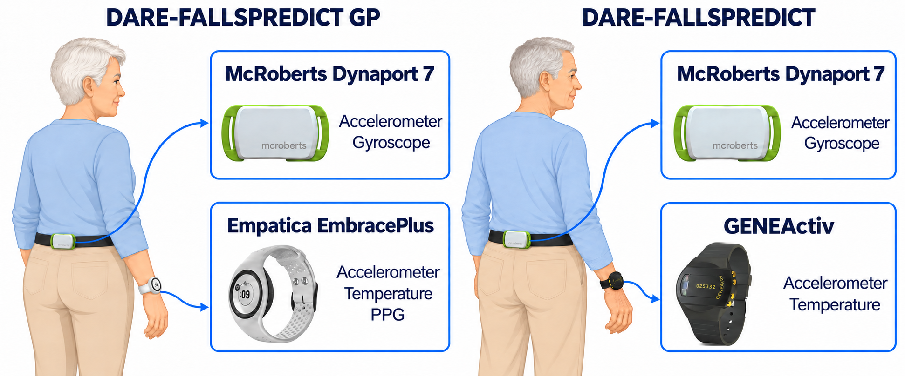
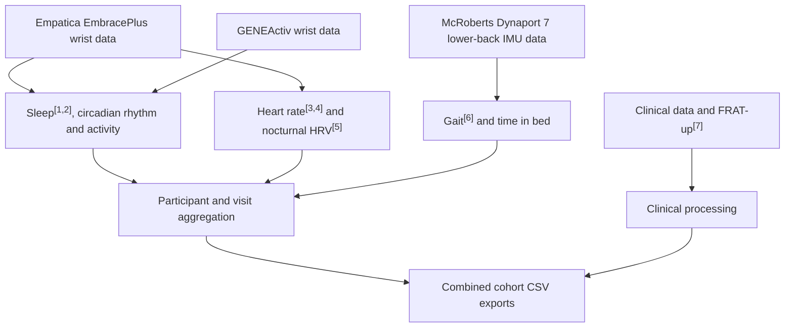

# DARE-wearable-pipelines

[](https://github.com/marcellosicbaldi/DARE-wearable-pipelines/actions/workflows/ci.yml)

Research wearable workflows for the DARE-FALLSPREDICT GP and DARE-FALLSPREDICT studies:

- Empatica EmbracePlus wrist sleep[1,2], circadian rhythm, activity intensity, heart rate[3,4] and HRV[5]
- GENEActiv wrist sleep[1,2], circadian rhythm and activity intensity
- McRoberts Dynaport 7 lower-back IMU gait[6] and time-in-bed processing
- Clinical data, FRAT-up[7] import and combined cohort aggregation

## Study setup



## Workflow overview

Device-specific preprocessing feeds shared feature extraction and aggregation
for both studies. Sensor summaries are joined with clinical data for combined
cohort exports.



## Contents

```text
configs/       Generic example configurations; no private study settings
docs/          Processing and data-contract documentation
notebooks/     Entry-point examples and lower-back nonwear/respiration experiments
scripts/       Batch launchers, research comparisons, reporting and publication checks
src/           Shared core and DARE-FALLSPREDICT GP/DARE-FALLSPREDICT adapters
tests/         Synthetic regression tests
```

## Shared architecture

Keep both cohorts in one repository and branch. Cohort differences are explicit
configuration and sensor adapters; separate branches would duplicate processing
fixes and make the two implementations drift.

```text
src/dare_wearables/     Sensor readers, preprocessing, algorithms, shared runners,
                       clinical processing and aggregation calculations
src/fallspredict_gp_pipeline/  DARE-FALLSPREDICT GP configuration, commands and default paths
src/fallspredict_pipeline/     DARE-FALLSPREDICT configuration, commands and GENEActiv orchestration
```

Both adapters depend on `dare_wearables`; the core imports neither cohort.
Empatica EmbracePlus and GENEActiv preprocessing retain their device-specific loading and
nonwear rules, then feed the same `run_wrist_from_preprocessed` stage sequence.
The shared lower-back runner accepts either cohort's configuration. Aggregation
adapters supply sensor folders and gait QC policy explicitly. Existing import
paths forward to the core or use small wrappers that preserve their defaults.

For new Python integrations, use the neutral APIs in
`dare_wearables.wrist.sleep.pipeline` (`run_wrist_from_empatica`,
`run_wrist_from_empatica_silver`, `run_wrist_from_preprocessed`) and
`dare_wearables.lower_back.pipeline` (`run_from_config`). Shared aggregation
functions require explicit roots and sensor subdirectories. See the
[architecture diagram](docs/pipeline_diagram.md).

## Setup and private configuration

Download a [GitHub release](https://github.com/marcellosicbaldi/DARE-wearable-pipelines/releases), or clone the repository and check out the desired release tag. Enter the repository directory,
and install [uv](https://docs.astral.sh/uv/getting-started/installation/) version
`0.12.23`. Then:

```bash
uv sync --locked
cp configs/empatica_sleep.example.toml configs/empatica_sleep.local.toml
```

This creates an isolated `.venv` and installs all three packages. For BeliefPPG
heart-rate inference, install the additional TensorFlow dependencies:

```bash
uv sync --locked --extra heart-rate
```

Activate the environment before running commands (`source .venv/bin/activate`
on macOS/Linux), or prefix each command with `uv run --no-sync`.
`uv sync` without the extra removes optional heart-rate dependencies; use
`uv run --no-sync` to preserve your chosen environment. HRV does not require
this extra.

For a plain pip installation from the downloaded source, use Python 3.11 and
`python -m pip install .` (or `'.[heart-rate]'`). This pins direct dependencies
but does not reproduce every transitive version from `uv.lock`; the locked
workflow above is the reference installation. See
[GitHub installation and releases](docs/installation_and_releases.md) for wheel
installation, dependency updates and release checks. The project is distributed
through GitHub only; it is not published on PyPI.

Copy each required `configs/*.example.toml` to the corresponding `*.local.toml`,
then edit that local file with your private paths and participant selection.
Local configuration files are ignored by Git and excluded from distributions.
Examples use the fictional identifier `900001`; no example data is supplied.

## Run

After preparing the matching local configuration:

```bash
gp-empatica-sleep --config configs/empatica_sleep.local.toml --participant 900001 --combined
ravenna-sleep --config configs/ravenna_sleep.local.toml --participant 900001 --combined
gp-lower-back --config configs/lower_back.local.toml --participant 900001
ravenna-lower-back --config configs/ravenna_lower_back.local.toml --participant 900001
gp-heart-rate --config configs/heart_rate.local.toml --participant 900001 --visit T0
gp-hrv --config configs/hrv.local.toml --participant 900001
```

Equivalent examples are in `notebooks/`. Keep notebook outputs cleared before
committing. Inspect participant selection before any batch run.

The reviewed GP T0 profile is explicit in `configs/lower_back.example.toml`.
For a new isolated cohort run, copy it to the ignored local configuration and
use the batch launcher:

```bash
cp configs/lower_back.example.toml configs/lower_back.local.toml
# Edit private paths before running; --inventory-only does not process signals.
.venv/bin/python scripts/run_lower_back_dataset.py --config configs/lower_back.local.toml --inventory-only
```

The default Python API and Ravenna example retain the compatibility nonwear
settings. Existing private TOML files must explicitly select the reviewed
profile; merging or upgrading code does not rewrite them. The [validation and
promotion notes](docs/lower_back_validation.md) describe the benchmark tradeoff,
source equivalence and dependent extraction steps.

For joint McRoberts/Empatica wear coverage, use
`scripts/summarize_joint_wear.py` with saved source directories and a new output
directory. It intersects timestamped intervals on the same 168-hour window;
see [wear coverage methods and command](docs/joint_wear_coverage.md).

For lower-back nonwear investigation, use
[`notebooks/compare_lower_back_nonwear.ipynb`](notebooks/compare_lower_back_nonwear.ipynb).
It compares the legacy Python detector with GGIR 2023 using matched thresholds and
two or three required axes, with cohort distributions, paired comparisons and
acceleration/bout plots. Copy `configs/nonwear_comparison.example.toml` to the ignored local copy
and select participants explicitly. Running the comparison requires `Rscript`
and downloads checksum-verified GGIR 3.3-9 routines on first use. Results go to
a new experiment directory; the comparison does not run gait or TIB.

For **manual diary-guided labeling**, launch the independent local app with
`.venv/bin/python scripts/annotate_lower_back_nonwear.py` after configuring
`configs/nonwear_annotation.local.toml` from the example. It shows synchronized
raw ACC/gyro, preserves original diary shading, and lets reviewers drag exact
boundaries, confirm/reject episodes, or add missed removals and wear examples.
Save/resume and confirmed-label CSV exports are separate from pipeline results.
See [annotation instructions](docs/nonwear_annotation.md) or the launcher in
[`notebooks/nonwear_annotation.ipynb`](notebooks/nonwear_annotation.ipynb).

[`notebooks/respiration.ipynb`](notebooks/respiration.ipynb) explores gyroscope
respiration-like spectral evidence as a proposed wear override, with 30/60-second
windows, per-axis spectra and before/after nonwear plots. It reuses saved
comparison results. The notebook and production runner share the spectral screen.

The lower-back detector implementation is `ggir_2023_matched`: the upstream
GGIR 2023 approach, using SD <13 mg and range <50 mg with at least two axes.
Compatibility API defaults use **60-minute forward windows and 15-minute
decisions**. The reviewed GP T0 configuration selects **30-minute windows and
one-minute decisions** with the respiration override described below.
It uses a NumPy port of the routines
pinned to GGIR 3.3-9 / commit `5acd50f9283e02fe0efc98057978dc8e9d5629ab`,
including overlapping-window scores and iterative wear-gap filling. Both profiles
disable GGIR's recording-end extension and special final-24-hour download rule:
participants are expected to wear the sensor through the seven-day protocol,
and the analysed seven-day cap is not evidence of sensor removal. Start-edge
correction is retained. Signal-supported nonwear at the end can still be detected.
For the reviewed GP T0 grid, the window, step and recording-end policy are
explicit in configuration and output provenance:

```toml
[lower_back.nonwear]
method = "ggir_2023_matched"
window_seconds = 1800.0
step_seconds = 60.0
end_of_recording_correction = false
```

For the historical upstream-equivalent profile, explicitly use
`window_seconds = 3600.0`, `step_seconds = 900.0` and
`end_of_recording_correction = true`. Historical
60-minute comparisons and saved outputs keep their original interpretation.
An early four-participant pilot retained the 60/15 profile. The subsequent fixed
20-participant benchmark selected 30/1 with a 30-second respiration override.
`configs/lower_back.example.toml` and `configs/lower_back_t0_inversion.example.toml`
now declare that reviewed GP T0 profile explicitly. Library defaults and the
Ravenna example retain 60/15 with respiration disabled. The recording-end fix
is enabled in both profiles. See [the benchmark and validation limits](docs/lower_back_validation.md).
Clipping is exported separately and excluded from the nonwear mask. Epochs use
exact sample bounds, including nanosecond timestamps; final partial decision
epochs remain outside the decisions (one minute or 15 minutes by profile).

**Production requires only Python**: no R process, source downloads or source
cache. `[lower_back.nonwear].method = "current"` explicitly selects the historical
Python implementation for reproducibility. The production default is GGIR even
when the respiration override is disabled. Changing this profile requires a new
assessment and recomputation of dependent outputs; saved labels are never relabelled
as if they had used the new settings. Obsolete `rscript` and `source_cache`
keys in older production TOML files are accepted and ignored.

R is needed only for the optional comparison and equivalence checks. To repeat
validation against the original pinned R functions on a random sample from a
previous R-backed, single-visit assessment:

```bash
python scripts/validate_ggir2023_python.py --assessment /absolute/path/to/r_assessment --output-root /absolute/path/to/validation --count 10 --seed 20261102 --workers 2
```

The sample is frozen before processing, without replacement, from previously
completed subjects; reader failures are recorded as ineligible. The check reruns
R and Python on identical full-rate calibrated acceleration, requires exact
scores/decisions, sample masks and bout timestamps, and compares respiration
features and final bouts with the preserved R-backed assessment. Results and a
report go to a new validation folder. R-dependent synthetic parity tests skip
when R is unavailable; production integration tests still run.

The lower-back runner supports a configurable **respiration override**. It is
enabled in the reviewed GP T0 examples and remains disabled in library defaults
and the Ravenna example. Both profiles use **10 < BR < 30 brpm at all hours**,
50% overlap and evidence from any gyro axis. The reviewed GP profile uses
30-second gyro windows; the compatibility screen uses 60-second windows. It uses
the upstream **GGIR 2023 matched-threshold** baseline, then reassigns only nonwear samples covered
by positive windows. It never creates nonwear. Gyro must be in degrees/s; no
temperature input is required. Missing/invalid windows and incomplete tails
preserve the accelerometer labels. Each complete window is assigned its full
support, so transitions have window-scale uncertainty.

To inspect the saved cohort results, use **Inspect saved results: raw ACC/gyro
and nonwear** near the top of `notebooks/respiration.ipynb`. Run its imports and
two inspection cells; no comparison or spectral analysis is required. Choose a
participant/visit, then a bout or timestamp range. The upper panel shows raw
acceleration and the lower panel raw gyro, with final nonwear, respiration-based
wear reassignments and short-bout reassignments shaded separately. Raw data are
cached once per recording; both plot limits set to `None` show the full recording.

The respiration example and local assessment configuration also set
`min_nonwear_bout_seconds = 900.0`. After respiration subtraction and splitting
at time gaps, this final rule reclassifies residual bouts **shorter than 15 minutes**
as wear. Bouts of exactly 15 minutes remain nonwear. Duration uses observed sample
counts; missing time is never filled or used to join bouts. Omitting this option
(or setting it to zero) reproduces the earlier respiration-only behavior.

For an isolated cohort assessment, copy
`configs/lower_back_respiration.example.toml` to an ignored local configuration,
set private paths and select visits/participants. Use a separate output root:

```bash
python scripts/assess_lower_back_nonwear.py configs/lower_back_respiration.local.toml --inventory-only
python scripts/assess_lower_back_nonwear.py configs/lower_back_respiration.local.toml --resume /absolute/path/to/assessment_run
```

The assessment computes nonwear only, without gait, TIB or raw-sample parquet
exports. It honors `lower_back.protocol_hours` in both serial and parallel workers,
using elapsed time from the first retained sample, including gaps. For the GP T0
window, set `protocol_hours = 168.0`; omitting it retains the historical sample-count
cap. The requested limit is recorded in each nonwear summary/provenance and its
completion signature, so results from a different limit cannot be reused.
Each subject's `nonwear/` folder contains original/evidence/reassigned/
final intervals, intervals before the duration filter, separate duration-based
reassignments, GGIR epoch decisions, respiration-window features, daily counts, parameter/source provenance
and a completion manifest. Sample intervals are half open; CSV timestamp ends
are exclusive. Resume verifies configuration, source revision, input identity and
output checksums. Failed recordings are reported while the others continue.
`cohort_summary.csv` and `cohort_qc.png` support review, including daytime
reassignments (09:00–21:00 is a reporting interval, never a detection gate).
Use `--cohort ravenna` for the other adapter. The default is one worker; increase
`--workers` only with enough RAM for multiple full-rate recordings.

To apply only the final duration rule to existing completed assessments, without
repeating the raw-signal analysis, use:

```bash
python scripts/refine_lower_back_nonwear.py /absolute/path/to/original_run /absolute/path/to/recovery_run --output-root /absolute/path/to/new_results --minimum-seconds 900 --expected-recordings 197
```

This verifies saved interval checksums, includes recovered failures and counts
matching controls once. A separate derived run contains final and reassigned
intervals, per-participant summaries, and before/after statistics. Episodes are
counted once; night is 22:00–08:00, and bouts crossing a day/night boundary are
assigned to whichever period contains more of their duration. Historical results
are preserved. This step does not update downstream gait/TIB outputs.

For a downstream rerun, use the normal lower-back CLI with respiration enabled
and a **new silver root**, then recompute dependent aggregates and any sleep
outputs that use lower-back TIB. The exported `wear_accelerometer` column preserves
the original labels, `wear_respiration_override` identifies respiration-based
reassignments, and `wear_short_nonwear_override` identifies duration-based
reassignments. The final `wear` is consumed by gait/TIB. The existing TIB-specific lying correction
remains a separate later step. Review known removals as well as quiet sleep
when assessing the selected profile's false-positive tradeoff.

### Selected nonwear profile: full GP dataset run

For GP T0 production, the standard `configs/lower_back.example.toml` and the
explicit **T0-only, inversion-only** profile below select the same processing
parameters. To retain a separately named configuration, use
[`configs/lower_back_t0_inversion.example.toml`](configs/lower_back_t0_inversion.example.toml).
Copy it to `configs/lower_back_t0_inversion.local.toml` and set private paths.
It selects all numeric participant directories, T0, 168 elapsed hours, the
winning nonwear profile described below, gait, lying/TIB and nap detection.
Start a new run with:

```bash
caffeinate -i env OPENBLAS_NUM_THREADS=1 OMP_NUM_THREADS=1 VECLIB_MAXIMUM_THREADS=1 \
  .venv/bin/python -u scripts/run_lower_back_dataset.py \
  --config configs/lower_back_t0_inversion.local.toml
```

On macOS, `caffeinate` keeps the machine awake while this command runs. Omit it
on other systems. The thread limits avoid excessive BLAS overhead. The launcher
prints its unique run directory. Repeat with `--resume /absolute/run_directory`
to reuse verified completed recordings and retry incomplete/failed ones. Use
`--inventory-only` with `--config` to prepare settings and file metadata without
starting participant processing. Resume only the new run, with its frozen code
and environment; the older interrupted run retains its historical algorithms.

The selected benchmark configuration is available in
[`configs/lower_back_selected_full.example.toml`](configs/lower_back_selected_full.example.toml).
It uses 30-minute ACC windows advanced every minute, SD <13 mg and range <50 mg
on at least two axes, GGIR continuity rules, and a 30-second gyro screen advanced
every 15 seconds. The respiration band is strictly 10–30 brpm at all hours;
remaining nonwear shorter than 15 minutes becomes wear. Recording-end extension
is disabled. The library defaults remain 60/15 minutes until
the selected profile is explicitly supplied. The standard GP example enables it;
existing private configurations are not rewritten.

The full-run example selects all numeric GP participant directories and T0/T1,
enables gait and posture/time-in-bed, disables large sample parquet exports, and
limits each recording to **168 elapsed hours**, matching the reviewed benchmark.
All timestamp gaps restart ACC/gyro analysis. Missing samples remain time-invalid;
benchmark annotations and participant-specific reference corrections are not
inputs to the cohort pipeline.

Copy the example to `configs/lower_back_selected_full.local.toml` and set the
absolute bronze, REDCap and new output-root paths. Prepare an inventory first:

```bash
.venv/bin/python scripts/run_lower_back_dataset.py --config configs/lower_back_selected_full.local.toml --inventory-only
```

This command reads file metadata, freezes settings/source hashes/dependency
versions and creates a new `full_run_*` folder. It does not decode sensor data or
execute the algorithms. Review `recording_inventory.csv`, including missing
visits, small files and ambiguous multiple-OMX folders. Start that exact run with:

```bash
.venv/bin/python scripts/run_lower_back_dataset.py --resume "/absolute/path/to/full_run_FOLDER"
```

Use the same `--resume` command after interruption or failure. Each recording
runs sequentially in its own Python process; logs stream into `logs/ID_VISIT.log`.
The launcher continues after individual failures and verifies hashes of **all**
nonwear, gait and TIB outputs before reusing a completed recording. Changed raw
inputs, metadata, code or dependency versions require restoring the frozen inputs
or starting a new run. Failed partial recording outputs are excluded from
aggregation. A failed run returns a nonzero exit status and is marked
`completed_with_failures`.

The new run folder contains:

- `run_plan.json`, `run_plan.sha256`, `source_snapshot/`: frozen configuration,
  input identities, code, versions and Git branch/commit/dirty state.
- `run_status.json`, `cohort_summary.csv`, `recording_inventory.csv`, `logs/`:
  completion status, exclusions, nonwear summaries and errors.
- `silver/ID/VISIT/McRoberts/`: full nonwear/audit, gait, posture and TIB outputs.
- `aggregation/gait_T0_mean.csv`, `gait_T1_mean.csv`: gait aggregates using the
  existing >16-hour daily wear rule.
- `aggregation/lower_back_tib_valid_all.csv`: combined valid TIB intervals with
  subject/visit columns, suitable as the new `lb_tib_csv_path` for GP wrist sleep.

All outputs stay under the new run folder. Existing production silver, manual
annotations and historical nonwear assessments are preserved. A source checkout
can also execute a fresh run directly by omitting `--inventory-only`.

The production runner corrects binary belt inversion once before gait and
lying, using the same corrected signals for both. It assumes that the belt
preserves the face toward the body. Identity or a 180-degree rotation about PA
is applied to both triads: vertical and ML reverse; PA remains unchanged.
There is **no tilt alignment**, including within gait sequences. The historical
all-axis reflection is retained only for reproduction of old comparisons.

Orientation evidence comes from acceleration-norm walking detection during
continuous final wear, split at nonwear, timestamp gaps and processing-segment
boundaries. Detection is bounded to one-hour chunks. Accepted sequences last
at least 10 seconds, have plausible/coherent gravity and a vertical component
of at least cos(45 degrees) in magnitude. A state needs at least three supporting
sequences, 60 duration-capped evidence seconds and 90% weighted consensus.
Evidence for both states meeting the same support requirements flags a possible
unrecognised removal rather than applying the majority state to the episode.
These are conservative processing rules, not validated accuracy thresholds.

Lying and nonwear never supply orientation evidence. Uncertain episodes keep
their input axes and are flagged. Nonwear receives the preceding episode's
state for the existing TIB gap filling; no state carries across a timestamp or
processing-segment discontinuity. Wear labels are unchanged by orientation.
`orientation/inversion_episodes.csv`, `walking_evidence.csv` and
`inversion_summary.json` contain states, evidence, coverage and parameters.
`cohort_summary.csv` reports inverted and uncertain wear hours. TIB QC adds
`orientation_uncertain_wear_hours_in_tib` and `orientation_review_required`;
these flags expose uncertainty without changing existing night-wear validity
criteria. The explicit `orientation_mode="sequence"` gait API and posture
tilt helper remain available only for experiments.

Gait `step_count` now counts detected initial contacts within assembled bouts;
`n_strides` retains the number of accepted stride intervals. Bout turn counts
use the bout containing each turn's midpoint. Plausibility thresholds receive
total participant height separately from the sensor height used for stride length.

To compare against a frozen pre-change run without modifying its outputs:

```bash
.venv/bin/python scripts/compare_lower_back_gait_orientation.py --baseline-run /absolute/path/to/full_run_FOLDER --output-root /absolute/path/to/new_comparison --participant 900001 --participant 900002
```

The comparison shares frozen preprocessing across four arms: historical gait,
count/height fixes with historical orientation, no orientation correction, and
per-sequence rotation. It exports sequence-equality checks, intermediate contacts,
turns and strides, daily and participant aggregates, and a comparison figure.
Existing full runs retain their source snapshots; this change requires a new
full-run plan rather than resuming an old plan from the modified checkout.

Posture mounting correction has a separate experimental comparison:

```bash
.venv/bin/python scripts/compare_lower_back_posture_orientation.py --gait-comparison /absolute/path/to/completed_gait_comparison --output-root /absolute/path/to/new_posture_comparison --participant 900001 --participant 900002
```

Its four arms use historical inversion, a proper 180-degree rotation with the
same historical mask, uncorrected signals, and a stable proper rotation per
continuous wear episode inferred from walking. Both sensor triads rotate;
lying windows never provide mounting calibration. The experiment reuses the
100-Hz preprocessing cache, infers the historical flip mask at 100 Hz, then
compares on the posture detector's 1-Hz grid. It preserves wear, lying
thresholds, gap filling and TIB/QC rules, and checks any completed original
posture outputs for exact reproduction. Outputs include mounting evidence QC,
lying-label disagreement, nightly boundaries/durations and validity, naps,
source snapshots and hashes. This experimental tilt comparison is separate
from the production binary-inversion method.

Walking gravity cannot distinguish mounting tilt from persistent trunk lean.
Unsupported episodes retain their input frame and explicit QC. The current
posture detector also estimates one recording-wide upright reference using
component-wise medians, which do not commute with arbitrary rotations. Mixing
corrected and unsupported frames can therefore affect other episodes through
that reference. Review weak evidence and large changes before promoting this
experimental correction; this comparison does not establish posture accuracy.

For dependent wrist sleep, set `lb_tib_csv_path` to the new combined TIB CSV in a
separate GP sleep configuration and use a new `output_root`. Recompute sleep
outputs/aggregates that use `lower_back_tib`, then refresh combined-cohort tables
using the existing private exclusion policy and minimum-data rules. HR/HRV and
other analyses must also be refreshed if they consume those updated sleep
windows. Unrelated sensor preprocessing does not need repeating.

To move the reviewed change into production:

1. Review `run_status.json` and cohort/gait/TIB QC after the user-run batch;
   resolve failures and account explicitly for skipped recordings.
2. Commit the reviewed code, tests, example configuration and documentation on
   `lower-back-nonwear`. Keep local configurations, logs, data and private
   benchmark outputs out of Git. Uncommitted changes are not isolated by merely
   switching branches.
3. Open a pull request to `main` referencing
   [issue #1](https://github.com/marcellosicbaldi/DARE-wearable-pipelines/issues/1).
   Include the fixed 20-participant benchmark, selected parameters, synthetic
   equivalence tests and cohort QC. The issue's original 9–30 brpm description
   should be distinguished from the selected strict 10–30 brpm setting.
4. After review and CI pass for the final commit, merge and make a versioned
   release following [installation/release instructions](docs/installation_and_releases.md).
   Install that revision in the analysis environment and retain its configuration
   and run manifest. Reusing a previous cohort run requires matching processing
   source hashes and dependencies; a Git commit alone is insufficient when the
   original run recorded local changes.
5. Activate the selected profile in the production GP configuration and point
   downstream processing to the reviewed run's `silver/` and `aggregation/`
   directories. Retain the previous paths for rollback rather than mixing files
   from different runs. Promote the corresponding dependent sleep/aggregate
   outputs together. No automatic merge, issue update, or data promotion occurs.

Verified McRoberts rollover-anchor glitches can be quarantined with an explicit
option; see [timestamp quality and recovery](docs/lower_back_timestamp_quality.md):

```toml
[lower_back.timestamps]
policy = "quarantine_bad_anchors"
```

The library timestamp default remains `strict`; the reviewed GP examples
explicitly enable recovery. Recovery excludes the short affected spans as
time-invalid observations, preserves retained timestamps and real recording
gaps, and exports a QC log. Recovered files use separate processing segments;
their missing time contributes neither wear nor nonwear. Unrecognized anomalies
still fail. Validate in a new output root before rerunning dependent outputs.

For recordings rejected with nonincreasing OMX timestamps, the read-only packet
audit can inspect failed recordings and a reproducible sample of completed
controls from an assessment:

```bash
python scripts/inspect_omx_timestamps.py --assessment /absolute/path/to/assessment_run --output-root /absolute/path/to/private_timestamp_audit --controls 10
```

The audit compares packet-boundary times, counters, header fields and checksums
around backward jumps. It exports per-stream summaries and packet context;
outputs contain private recording dates and participant IDs. It neither repairs
timestamps nor runs downstream processing. Counter resets and forward gaps must
be assessed separately from temporary bad timestamp anchors.

## Input and output contracts

Empatica EmbracePlus sleep expects `silver/<participant>/<visit>/Empatica/acc.parquet` and
`temp.parquet`. HR and HRV expect `ppg.parquet` and `acc.parquet`. HRV also uses
sleep windows from `Empatica/sleep_circadian/sleep_output_all_guiders.csv`.
Optional diary, recruitment tracker and lower-back TIB inputs are configured
privately. GENEActiv expects a participant/visit `.bin` recording; see the
[DARE-FALLSPREDICT input conventions](src/fallspredict_pipeline/README.md).

McRoberts Dynaport 7 lower-back processing expects
`bronze/<participant>/<visit>/<sensor>/*.OMX`
and requires clinical metadata for gait processing. Its outputs include daily
gait, walking bouts, nonwear and time-in-bed tables. Wrist outputs live under
the participant/visit/sensor folder, with `sleep_circadian`, `beliefppg`, `hrv`
and `nocturnal_bursts` subdirectories as selected by the configuration.

All generated outputs and clinical/sensor inputs remain private. Omitting an
ID column from an export is not an anonymization procedure.

## Aggregation

```bash
gp-aggregate-all --silver-root "$HOME/dare-data/silver" --visit T0
gp-aggregate-redcap --redcap-csv "$HOME/dare-data/REDCap/Bologna/fallspredict_data.csv" --output-dir outputs/redcap
```

See [combined cohort assembly](docs/combined_cohorts.md),
[clinical data processing](docs/redcap_processing.md), and
[aggregation thresholds](docs/aggregation_thresholds_and_nonwear.md).

## Checks

```bash
uv run --no-sync python -m unittest discover -s tests -v
uv run --no-sync python scripts/check_publication.py
uv run --no-sync python scripts/check_install.py
```

The publication check inspects Git-visible working files and staged content
for disallowed files, local paths, common credential patterns and notebook
execution state. It reports locations, not sensitive values. It does not inspect
Git history or certify arbitrary text as anonymous; keep future additions limited
to reviewed code, prose and synthetic examples.

## References

1. **Sleep (sustained inactivity):** van Hees, V. T., et al. (2015).
   [A Novel, Open Access Method to Assess Sleep Duration Using a Wrist-Worn Accelerometer](https://doi.org/10.1371/journal.pone.0142533).
   *PLOS ONE*, 10(11), e0142533.
2. **Sleep (HDCZA):** van Hees, V. T., et al. (2018).
   [Estimating sleep parameters using an accelerometer without sleep diary](https://doi.org/10.1038/s41598-018-31266-z).
   *Scientific Reports*, 8, 12975.
3. **Heart rate (BeliefPPG):** Bieri, V., Streli, P., Demirel, B. U., and Holz, C. (2023).
   [BeliefPPG: Uncertainty-aware heart rate estimation from PPG signals via belief propagation](https://proceedings.mlr.press/v216/bieri23a.html).
   *UAI*, Proceedings of Machine Learning Research, 216, 173–183.
4. **Heart-rate benchmarking:** Sicbaldi, M., et al. (2025).
   [Benchmarking of open-source algorithms for heart rate estimation from motion-corrupted photoplethysmography](https://doi.org/10.1016/j.compbiomed.2025.110808).
   *Computers in Biology and Medicine*, 196, 110808.
5. **PPG beat detection (MSPTDfast):** Charlton, P. H., Mant, J., and Kyriacou, P. A. (2024).
   [MSPTDfast: An Efficient Photoplethysmography Beat Detection Algorithm](https://doi.org/10.22489/CinC.2024.045).
   *Computing in Cardiology*, 51, 1–4.
6. **Gait (MobGap):** Kirk, C., et al. (2026).
   [Mobgap: A State-of-the-Art Python Framework for Reproducible Estimation and Algorithm Validation of Digital Mobility Outcomes from a Single Wearable Device](https://doi.org/10.3390/s26134294).
   *Sensors*, 26(13), 4294.
7. **Fall-risk assessment (FRAT-up):** Cattelani, L., et al. (2015).
   [FRAT-up, a Web-based Fall-Risk Assessment Tool for Elderly People Living in the Community](https://doi.org/10.2196/jmir.4064).
   *Journal of Medical Internet Research*, 17(2), e41.

## Licensing and attribution

This project is licensed under the [MIT License](LICENSE).
Third-party code retains its original notices; see
[third-party notices and provenance](THIRD_PARTY_NOTICES.md) and `licenses/`.
